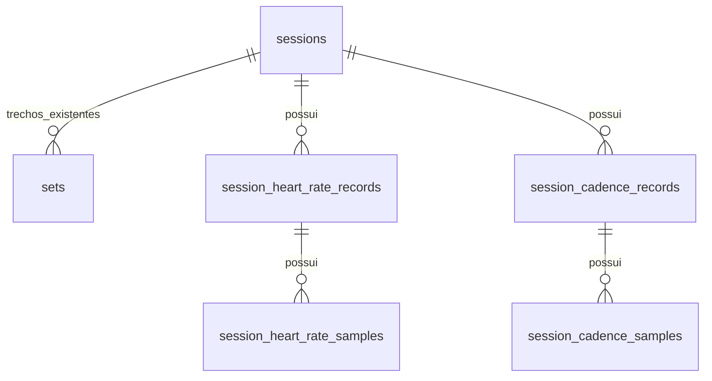

# Corrida: percepção de esforço, frequência cardíaca e cadência

Status: proposta de modelagem. Não altera o banco nem implementa sincronização.

## Escopo e linguagem

O usuário confirmou Android, Amazfit Bip 6 e **percepção de esforço**.
A origem futura das medições será Zepp → Health Connect, cuja disponibilidade
real de dados durante uma corrida ainda precisa ser validada no aparelho.

- **Corrida:** uma sessão com modalidade `corrida`.
- **Percepção de esforço (RPE da sessão):** nota informada pela pessoa, de 0 a 10,
  para a corrida inteira. Não é pace, frequência cardíaca nem uma nota calculada
  pelo relógio. A proposta usa a escala 0–10 e aceita casas decimais, como os
  campos numéricos já existentes.
- **Trecho:** parte da corrida, como um tiro ou uma volta. Os registros de
  distância existentes em `sets` continuam representando os trechos.
- **Registro cardíaco:** dados de uma fonte sobre a frequência cardíaca durante
  a sessão. Pode conter apenas um resumo ou uma sequência de medições.
- **Amostra cardíaca:** um valor em bpm em um instante específico.
- **Cadência de corrida:** taxa de passos por minuto (`passos/min`), contando
  os dois pés. É uma métrica de movimento, independente da frequência cardíaca.
- **Amostra de cadência:** uma taxa de passos/min em um instante específico;
  a sequência dessas amostras permite visualizar a cadência ao longo da corrida.
- **Cadência média e máxima:** resumos do período coberto, informados pela
  origem ou calculados das amostras, com essa distinção explícita.

## Estado atual

`Session` já tem identidade, modalidade, data e horários opcionais.
`WorkoutSet` tem distância em km, duração em segundos e pace em segundos/km.
Também possui `rpe`, hoje utilizado no preenchimento de séries de musculação.
O formulário de corrida não coleta percepção de esforço, frequência cardíaca
nem cadência.

A corrida não precisa de outra identidade paralela a `sessions`. Não mover os
campos de força ou duplicar distância/duração neste incremento. A evolução de
`sets` para uma entidade específica de trecho pode ocorrer em trabalho separado.

## Modelo proposto

### 1. Percepção de esforço na sessão

Adicionar a `sessions`:

| Campo | Tipo | Regra |
| --- | --- | --- |
| `perceived_exertion` | REAL, nullable | Entre 0 e 10, inclusive |

`NULL` significa não informado; `0` é uma nota válida. O registro é opcional,
editável depois da corrida e nunca preenchido a partir dos batimentos.
A sincronização de métricas do relógio não sobrescreve esse campo manual.
`sets.rpe` permanece independente: esforço de um trecho não equivale ao esforço
da sessão inteira, e não se calcula o segundo pela média do primeiro.

### 2. Registros cardíacos

Nova tabela `session_heart_rate_records`:

| Campo | Tipo | Finalidade |
| --- | --- | --- |
| `id` | INTEGER PK | Identidade local |
| `uuid` | TEXT UNIQUE, obrigatório | Identidade estável para backup/importação |
| `session_id` | FK, obrigatório | Sessão à qual os dados pertencem |
| `source` | TEXT, obrigatório | `manual`, `health_connect` ou `fit` |
| `source_scope` | TEXT, obrigatório | Namespace do provedor/armazenamento; `local` para manual |
| `origin_app` | TEXT, nullable | Aplicativo que escreveu os dados, quando conhecido |
| `device_name` | TEXT, nullable | Dispositivo informado pela origem; não presumir pelo provedor |
| `external_record_type` | TEXT, nullable | Tipo do registro externo, como `HeartRateRecord` |
| `external_record_id` | TEXT, nullable | Identificador externo do registro |
| `source_modified_at` | TEXT, nullable | Última modificação conhecida na origem |
| `reported_avg_bpm` | REAL, nullable | Média informada manualmente ou fornecida pela origem |
| `reported_max_bpm` | INTEGER, nullable | Máxima informada manualmente ou fornecida pela origem |

Um registro externo pode trazer somente amostras; nesse caso os campos de resumo
reportado ficam nulos. Um resumo pode existir sem amostras; nesse caso não há
base para desenhar uma curva. Não gerar amostras a partir de uma média/máxima.

Os registros são fragmentos da origem, não voltas nem trechos da corrida.
Vários registros do Health Connect podem compor a sequência de uma única corrida.

Índice único para registros externos:
`(session_id, source, source_scope, external_record_type, external_record_id)`,
aplicado somente quando o identificador externo não for nulo. Um registro manual
por sessão, com unicidade parcial para `source = 'manual'`.

Valores cardíacos devem ser positivos quando presentes; média reportada não pode
ser maior que a máxima reportada do mesmo resumo. Não impor um teto arbitrário
baseado em idade. Leitura ausente/inválida não vira zero bpm.

### 3. Amostras cardíacas

Nova tabela `session_heart_rate_samples`:

| Campo | Tipo | Finalidade |
| --- | --- | --- |
| `id` | INTEGER PK | Identidade local |
| `record_id` | FK, obrigatório | Registro de origem |
| `sample_index` | INTEGER, obrigatório | Posição original no registro |
| `recorded_at_ms` | INTEGER, obrigatório | Instante UTC, em milissegundos desde epoch |
| `bpm` | INTEGER, obrigatório | Medição positiva |

Unicidade `(record_id, sample_index)`. Índice `(record_id, recorded_at_ms)` para
leitura ordenada. Não assumir uma amostra por segundo nem colapsar registros de
dispositivos diferentes apenas por terem o mesmo horário.

Excluir uma sessão elimina seus registros e amostras por cascade. Atualizar um
registro externo substitui atomicamente as amostras daquele registro, preservando
os dados manuais e os registros de outras fontes.

### 4. Registros e amostras de cadência

Criar `session_cadence_records` com os mesmos campos de identidade e procedência
dos registros cardíacos (`id`, `uuid`, `session_id`, `source`, `source_scope`,
`origin_app`, `device_name`, `external_record_type`, `external_record_id` e
`source_modified_at`), substituindo os campos de resumo por:

| Campo | Tipo | Regra |
| --- | --- | --- |
| `reported_avg_steps_per_min` | REAL, nullable | Média reportada, maior ou igual a zero |
| `reported_max_steps_per_min` | REAL, nullable | Máxima reportada, maior ou igual a zero |

Criar `session_cadence_samples`:

| Campo | Tipo | Finalidade |
| --- | --- | --- |
| `id` | INTEGER PK | Identidade local |
| `record_id` | FK, obrigatório | Registro de cadência de origem |
| `sample_index` | INTEGER, obrigatório | Posição original no registro |
| `recorded_at_ms` | INTEGER, obrigatório | Instante UTC em milissegundos desde epoch |
| `steps_per_min` | REAL, obrigatório | Taxa de passos/min, maior ou igual a zero |

Aplicar as mesmas regras de unicidade externa, registro manual único por sessão,
índices de amostras, substituição atômica e cascades do modelo cardíaco.
Quando ambos os resumos estiverem presentes, média não pode exceder máxima.
Os valores devem ser finitos. Zero é válido quando a fonte registra ausência de
passos; ausência de leitura é `NULL` ou lacuna, nunca um zero fabricado.

O modelo aceita resumo sem amostras e amostras sem resumo reportado. Não criar
um campo escalar adicional chamado apenas `cadence` na sessão: a cadência ao
longo do tempo pertence às amostras, enquanto média e máxima são resumos.
Não gerar uma curva a partir desses dois números.

A unidade canônica é passos/min dos dois pés. Uma futura fonte que forneça
passadas completas/min ou outra convenção exige conversão explícita e
documentada no adaptador; nunca multiplicar por dois com base no valor observado.
Cadência de pedalada usa outra semântica e fica fora deste incremento.

## Resumo exibido e cálculos

O contrato de leitura pode retornar:

- RPE da sessão, opcional.
- Média e máxima **reportadas**, com sua origem.
- Média e máxima **calculadas**, se houver amostras, identificadas como calculadas.
- Quantidade de amostras, primeiro/último instante e lacunas de aquisição.
- Série temporal para o gráfico, mantendo os dados originais no banco.

Não armazenar o resumo calculado como outra verdade editável. Não substituir
silenciosamente o resumo reportado pelo calculado: podem usar recortes e métodos
diferentes. Sem política definida para duração representada por cada amostra e
para lacunas, não apresentar uma média como se cobrisse a corrida inteira.
Uma média temporal deve usar somente intervalos cobertos, com regra documentada;
a média aritmética de amostras irregulares não é uma média temporal.

Escolher uma fonte/dispositivo para a curva e para o resumo calculado. A junção
de fragmentos dessa fonte deve eliminar sobreposição sem somar ou promediar
sensores concorrentes. Fonte ambígua não deve ser escolhida silenciosamente.

Zonas cardíacas e carga baseada em duração × RPE ficam fora do primeiro incremento.
Exigiriam regras explícitas de cálculo e, para zonas, limites configurados e
preservados historicamente. Nenhuma dessas métricas se chama apenas "esforço".

### Cadência no detalhe da corrida

- Campos opcionais de preenchimento manual: **Cadência média** e **Cadência
  máxima**, ambos com unidade `passos/min` e aceitando casas decimais.
- Curva **Cadência** somente quando houver amostras, com horário/tempo decorrido
  e valor em passos/min. O gráfico é histórico; aquisição ao vivo fica fora
  deste incremento.
- Resumos reportados e calculados separados e com origem identificada, seguindo
  as mesmas regras de seleção de fonte, sobreposição e lacunas dos batimentos.

A máxima calculada é o maior valor das amostras válidas da fonte selecionada no
período da sessão, sem inventar cobertura nas lacunas. Uma média temporal exige
política explícita de cobertura; enquanto essa política não estiver definida,
exibir a média reportada quando existir e não oferecer uma média calculada como
resumo da corrida. Não fazer média simples das médias de fragmentos, nem excluir
zeros reais silenciosamente. A interface deve distinguir ausência de dados de
cadência zero.

Não deduzir cadência de pace/distância nem tratar cadência mais alta como recorde
ou melhoria automática. O primeiro incremento descreve os dados, sem metas de
cadência ou recomendações de técnica.

## Integração futura: fronteira do modelo

Health Connect guarda sessão de exercício e registros cardíacos separadamente.
Para associar amostras, usar período da sessão e procedência, verificando
ambiguidades. Sobreposição temporal sozinha não prova que uma medição pertence
àquela atividade. O nome do relógio só é preenchido se a origem o informar.

Além dos registros cardíacos, o futuro conector precisará de uma relação própria
entre a sessão local e o `ExerciseSessionRecord` externo. Não confundir o ID da
corrida com o ID de um `HeartRateRecord`, nem usar data/distância como chave única.
Tokens e cursores do Health Connect são estado local da integração, não dados da
corrida e não devem ser transportados como cursores reutilizáveis em backups.

Para cadência de passos, o Health Connect oferece `StepsCadenceRecord`, separado
dos registros cardíacos e da sessão de exercício. O conector deve validar no
aparelho se o Zepp realmente publica essas amostras; suporte do Health Connect
ao tipo não comprova disponibilidade no Amazfit Bip 6. Aplicam-se os mesmos
cuidados de associação por período e procedência. Agregações do provedor devem
reter a informação do período e da fonte usados no cálculo; não transformar uma
agregação de várias fontes em resumo atribuído a um único registro externo.

Importar/atualizar os dados do relógio nunca apaga a nota manual de esforço.
O conector deve suportar batimentos que cheguem depois da atividade.
A política de exclusão de atividades na origem será definida junto do conector;
excluir um registro cardíaco remove suas amostras, não a sessão inteira.

## Migração e entrega

1. Adicionar `perceived_exertion` nullable. Sessões existentes continuam com `NULL`;
   não copiar ou tirar média de `sets.rpe`.
2. Criar registros e amostras cardíacas e de cadência com chaves, índices e
   cascades. SQL permanece em `src/db/`.
3. Atualizar tipos, queries e importação/exportação versionada. Referências nos
   backups usam UUIDs; IDs numéricos locais não viajam entre dispositivos.
4. Acrescentar o preenchimento manual de RPE, resumo cardíaco e cadência média/
   máxima em corridas.
5. Exibir a curva somente quando existirem amostras. Não inventar dados para treinos antigos.
6. Implementar o conector Android em trabalho separado, após confirmar quais dados
   o Zepp efetivamente disponibiliza no Health Connect.

A musculação mantém seus RPEs por série e não exige nenhum novo campo de
preenchimento. O modelo cardíaco pode atender outras modalidades posteriormente,
sem obrigá-las a terem esses dados.

## Validação necessária na implementação

- Migração preserva sessões, trechos e métricas antigas; sem RPEs ou FCs fabricados.
- RPE ausente difere de zero; limites são validados no banco e na entrada.
- Resumo sem amostras é válido e não produz gráfico.
- Reimportar/atualizar um registro não duplica amostras nem altera RPE manual.
- Fragmentos sobrepostos e sensores concorrentes não são promediados entre si.
- Lacunas e horários UTC não deslocam as medições para outra corrida/dia local.
- Backup/restauração preserva valores, UUIDs, procedência e relacionamentos.
- Inserções/atualizações/exclusões do lote são atômicas.
- Cadência preserva casas decimais e zeros reais; rejeita negativos e não finitos.
- Média de cadência reportada não excede a máxima quando ambas existem.
- Resumo de cadência sem amostras não produz curva; amostras sem resumo permitem
  curva e máxima calculada, sem inventar uma média da corrida.
- Reimportação de cadência preserva UUIDs, RPE e resumos manuais; fontes
  concorrentes permanecem distintas.
- A conversão de unidades é explícita por formato de origem e não duplica uma
  cadência que já esteja em passos/min dos dois pés.

## Referências

- [Health Connect: sessões e dados associados](https://developer.android.com/health-and-fitness/health-connect/experiences/workouts)
- [Health Connect: amostra de frequência cardíaca](https://developer.android.com/reference/kotlin/androidx/health/connect/client/records/HeartRateRecord.Sample)
- [Health Connect: sincronização e IDs externos](https://developer.android.com/health-and-fitness/health-connect/sync-data)
- [Health Connect: cadência de passos e agregações](https://developer.android.com/health-and-fitness/health-connect/features/steps)
